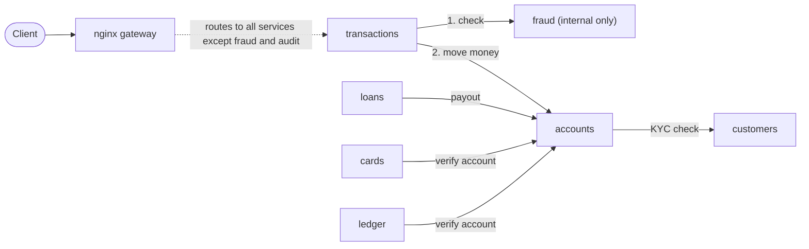
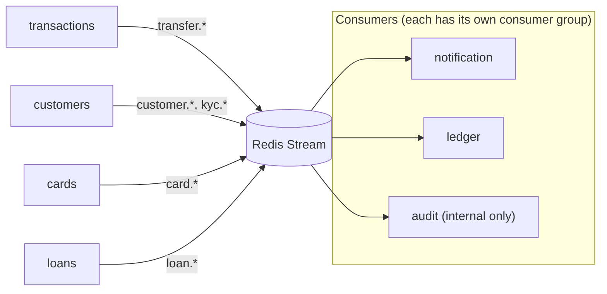

# Start here

## What you are building toward

A single repository (or a small set of repos) that proves you can take an application from a developer laptop to a monitored, secured, automatically deployed system. That is the job. Hiring managers for junior DevOps roles want **evidence**, and this is how you create it.

## Architecture

**1. Synchronous calls** (the customer is waiting for an answer):

`auth` and `notification` do not call any other service, so they do not appear here. Every call above is a plain HTTP request that can fail, which is why each caller has a timeout and a clear failure behaviour.

**2. Events** (things that can happen a moment later, through a Redis Stream):

Every service also owns **its own database** (not drawn, to keep the picture readable). `fraud` and `audit` are internal only: the gateway does not route to them.

**A customer's journey (what the smoke test does):**

1. Register and log in with `auth` (JWT).
2. Create a profile in `customers`. KYC starts as `pending`; a compliance step marks it `verified` (an internal call in this demo).
3. Open accounts in `accounts`. With `REQUIRE_KYC=true` this is refused until KYC is verified.
4. Transfer money: `transactions` asks `fraud` first (allow, review or deny), then `accounts` moves the money in one database transaction, then the result is published as an event.
5. Issue and freeze a card in `cards`. Take a loan in `loans`: it decides, pays out via `accounts`, and publishes an event.
6. Asynchronously, `notification` stores messages, `ledger` writes double-entry rows for the statement, and `audit` records everything.

**Design decisions worth knowing (interviewers ask):**

- **Money is integer cents**, never floats.
- **Each service owns its database.** That is the microservices rule. It means `loans` cannot just `UPDATE` a balance; it must ask `accounts` through an API.
- **`/health` vs `/ready`:** liveness never checks dependencies (otherwise a database blip makes Kubernetes restart healthy pods); readiness does (so traffic stops going to a pod that cannot serve).
- **Idempotency keys** make retries safe: a network timeout does not cause a double payment.
- **Synchronous vs asynchronous:** things the customer is waiting for (fraud check, moving money) are direct HTTP calls. Things that can happen a moment later (notifications, ledger, audit) are **events**, so those services can be slow or down without breaking a transfer.
- **Why Redis Streams, not a plain list:** a list item goes to one consumer. A stream with **consumer groups** gives every service its own copy of every event, and remembers where each one stopped, so a service that was down **catches up** when it returns. This was tested: `ledger` was killed during a transfer and wrote the missing entries after restart.
- **At-least-once delivery means duplicates happen,** so every consumer ignores an `event_id` it has already seen.
- **Fail closed or fail open?** If `fraud` is down, transfers return 503 (fail closed) because letting money move unchecked is worse than an outage. This is configurable (`FRAUD_FAIL_OPEN`); know both sides of the trade-off.
- **Event publishing is best-effort:** a bus outage must not fail a transfer that already succeeded. The cost is a lost event (a known gap: the **outbox pattern** fixes it; you will meet it in Phase 11).
- **Least exposure:** `fraud`, `audit` and every `/internal/*` path are unreachable from outside the cluster; internal calls need a shared token.
- **Shared code is copied, not imported** (`shared/` plus `scripts/sync_shared.sh`), so each service builds on its own. The cost is duplication; know the trade-off against a shared library.

## How to work (the habits that make this "company standard")

1. **One branch per task, one pull request per branch.** Never commit to `main` directly (you will enforce this in Phase 0).
2. **Small commits with clear messages.** "Add Dockerfile for auth service" beats "stuff".
3. **Every phase ends with acceptance criteria.** Do not move on until every box is ticked.
4. **Write a short note after each phase** in `docs/journal.md`: what you built, what broke, how you fixed it. This becomes your interview material.
5. **Break it on purpose.** Each phase lists failures to cause deliberately. Debugging is the real skill.
6. **Never commit secrets.** No `.env`, `.pem`, AWS keys, tokens. If you do, rotate them; deleting the commit is not enough.
7. **Clean up cloud resources** at the end of every session that created them (see the cost notes).

## What the docs give you, and what they do not

The phase guides give goals, hints and checks. They deliberately **do not hand you finished Dockerfiles, workflows or Terraform**. Writing those yourself is the learning. When you are stuck for more than 30–40 minutes, ask for a hint, then for a reference solution only as a last resort, and compare it against your own work.

## Suggested pace

About 2–4 weeks part-time for Phases 0–3, then roughly a week per phase after that. Phases 4–6 cost money on AWS; do them with a budget alert set. Phases 7–12 run entirely free on your own machine.

## Tools you will need

Git, a GitHub account, Docker (Desktop or Engine in WSL), Python 3.11+, VS Code. Later: Terraform, Ansible, kubectl, kind, Helm, an AWS account (with MFA and a budget alert from Week 8).
